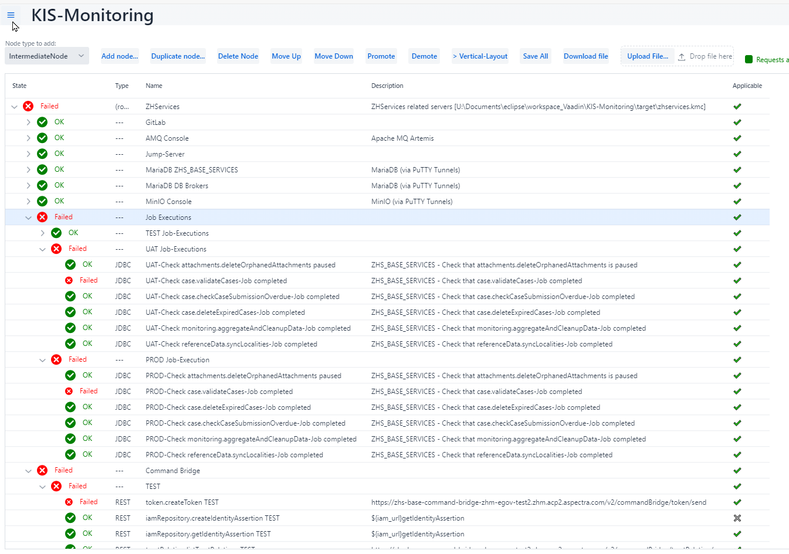

# KIS-Monitoring

KISMON (for "Keep-it-simple Monitoring") is a SpringBoot project whose goal it is to monitor the liveness and 
responsiveness of web-application servers and entire setups or "environments", 
i.e. compounds of components such as a DB, a Mock-Server (if applicable), a Proxy-server or load-balancer (if applicable) 
and the WebServer(s) and the application(s) running on it/them that are required for an application to run.

Components for a tree and can be organized and grouped in subtrees. The requests used to probe for the corresponding 
element's conditions can be defined on "leaf-nodes" in that tree. 
For each such "leaf node" conditions can be defined what response is to be considered as "OK". If that condition is 
not met it is considered as "Failed".

`Intermediate Nodes` summarize the results of their respective children. That "summarization" can be configured, i.e. 
there are several conditions to choose from what combination of children states is to be considered as `OK`, 
`Degraded` or `Failed` for a parent node. 
Such conditions can be "All children must be OK", "At maximum one children is allowed to be not OK", "at most one 
child must be OK" (this condition can be used to verify that exactly one and only one child is active at a 
time, e.g. in failover setups), etc. 
States "bubble up", i.e. on the next hierachy level the next summarization of children states is applied etc. 
up all the way to the root node.
With such a setup it is easy to spot which elements of a larger setup work and which don't. This may not provide 
the immediate root cause but it helps greatly at locating the sub-component that may be the reason why a setup or 
an environment does not work.

Request-types that are supported by KISMON are `REST`- and `SOAP`-requests, `JDBC`-requests (i.e. DB queries), `PING` 
and `SSH`, the latter meaning a "command-line" that is executed after logging into the target system using an SSH connection. 
This command-line can be any shell command line like a single command, a script name or a compound of several 
concatenated (piped) commands.

Requests are specified using a "form" which opens at the right when double-clicking on the first part (the icon) of 
the corresponding line in the tree. One can shift the divider between the left-hand tree view and the right-hand "form".
The form contains a generic section (with name, a description/comment, and a few field defining if and how frequent 
that request is to be executed and whether it is to be taken into account when calculating the parent node status).
Below that section are a couple of "accordeons", i.e. sections that can be opened (expanded) and closed (collapsed) 
describing the "connection details", the "response details", "validation details" and "action details". 
The content of these sections varies depending on the request *type*. 

* The response details of `REST`- and `SOAP`-commands are the resulting responses from the connected service.
* The response of a `JDBC`-command is the resulting DB-output, i.e. a table containing the query results ordered by column.
* The response of a `PING`-command is the result of a ping-command as executed on a command-line (KISMON extracts the 
response time from that result).
* The response of an `SSH`-command the resulting output of the command executed on the logged-in user's shell.

## Configuring the application

### Configuration via Forms

... To be completed ...

### Configuration via a JSON Config File

KISMON saves all its configs in a configuration files  

... To be completed ...

## Running the Application

### Running on the command line:

... To be completed ...

### Running from an IDE:
There are two ways to run the application :  using `mvn spring-boot:run` or by running the `Application` class directly from your IDE.

You can use any IDE of your preference, but we suggest Eclipse or IntelliJ IDEA.
Below are the configuration details to start the project using a `spring-boot:run` command. Both Eclipse and IntelliJ IDEA are covered.

#### Eclipse
- Right click on a project folder and select `Run As` --> `Maven build..` . After that a configuration window is opened.
- In the window set the value of the **Goals** field to `spring-boot:run` 
- You can optionally select `Skip tests` checkbox
- All the other settings can be left to default

Once configurations are set clicking `Run` will start the application

#### IntelliJ IDEA
- On the right side of the window, select Maven --> Plugins--> `spring-boot` --> `spring-boot:run` goal
- Optionally, you can disable tests by clicking on a `Skip Tests mode` blue button.

Clicking on the green run button will start the application.

After the application has started, you can view your it at http://localhost:8085/ in your browser.

If you want to run the application locally in the production mode, use `spring-boot:run -Pproduction` command instead.

## Project overview

Project follow the Maven's [standard directory layout structure](https://maven.apache.org/guides/introduction/introduction-to-the-standard-directory-layout.html):
- Under the `srs/main/java` are located Application sources
   - `Application.java` is a runnable Java application class and a starting point
   - `MainView.java` is a default view and entry point of the application
- Under the `srs/test` are located test files
- `src/main/resources` contains configuration files and static resources, most notably the `application.properties` file
which is used to configure the application for your environment.

- The `frontend` directory in the root folder contains client-side dependencies and resource files
   - All CSS styles used by the application are located under the root directory `frontend/styles`    
   - Templates would be stored under the `frontend/src`

## More Information on Vaadin

- Vaadin Basics [https://vaadin.com/docs](https://vaadin.com/docs)
- More components at [https://vaadin.com/components](https://vaadin.com/components) and [https://vaadin.com/directory](https://vaadin.com/directory)
- Download this and other examples at [https://vaadin.com/start](https://vaadin.com/start)
- Using Vaadin and Spring [https://vaadin.com/docs/v14/flow/spring/tutorial-spring-basic.html](https://vaadin.com/docs/v14/flow/spring/tutorial-spring-basic.html) article
- Join discussion and ask a question at [https://vaadin.com/forum](https://vaadin.com/forum)

## Notes

If you run application from a command line, remember to prepend a `mvn` to the command.
